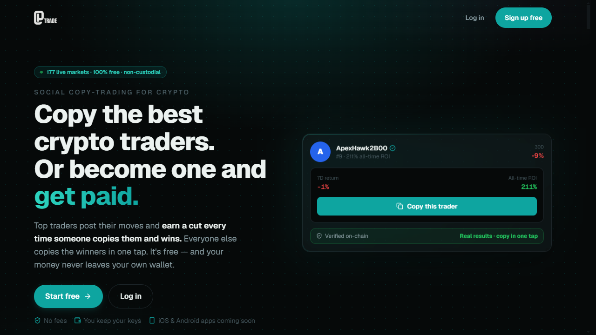
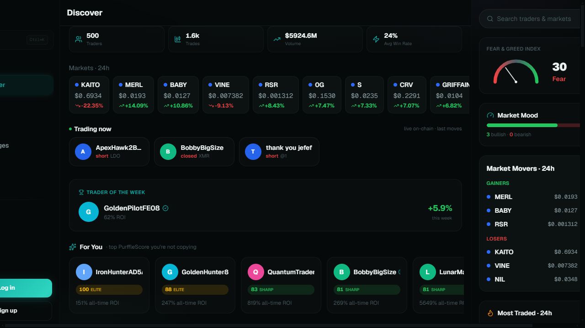
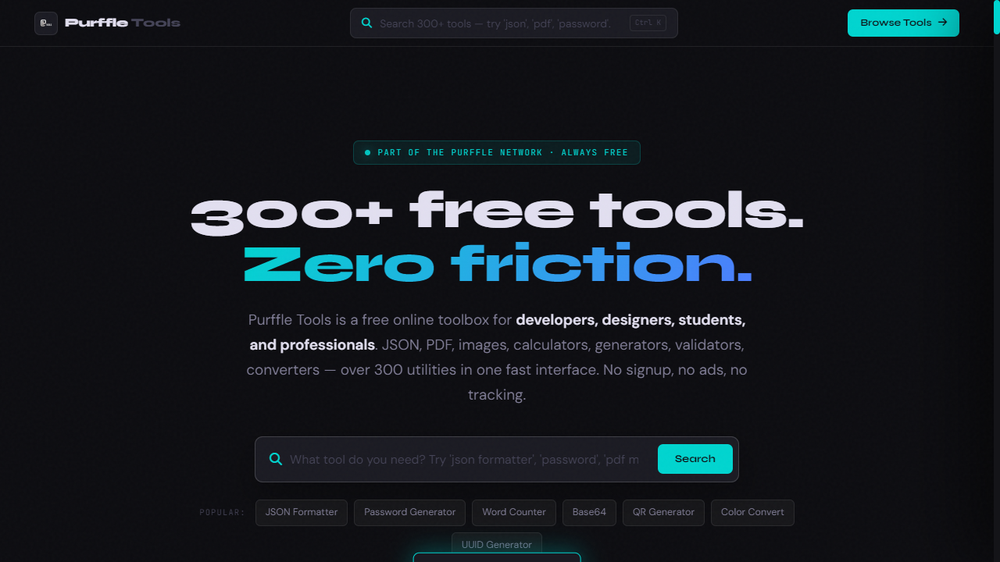
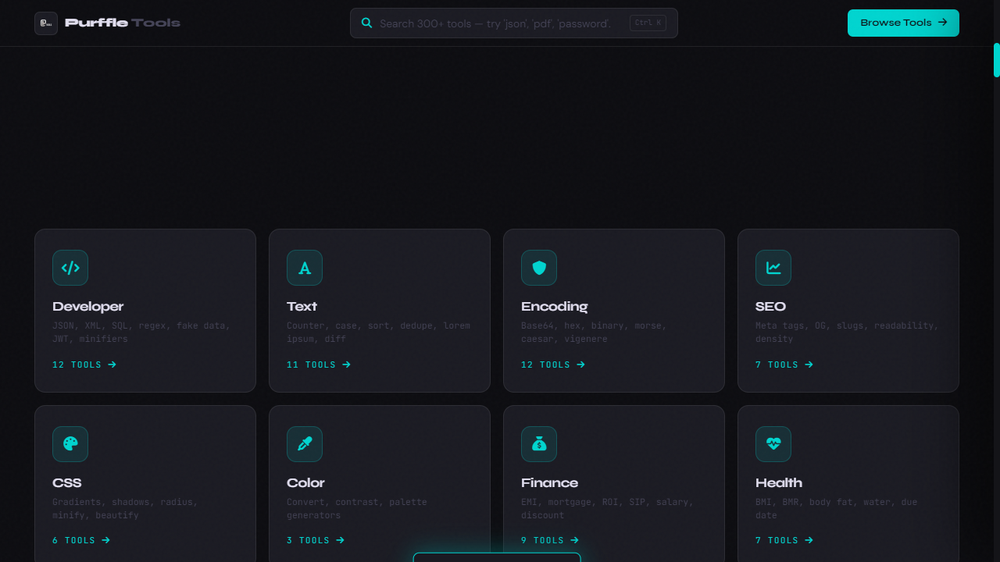
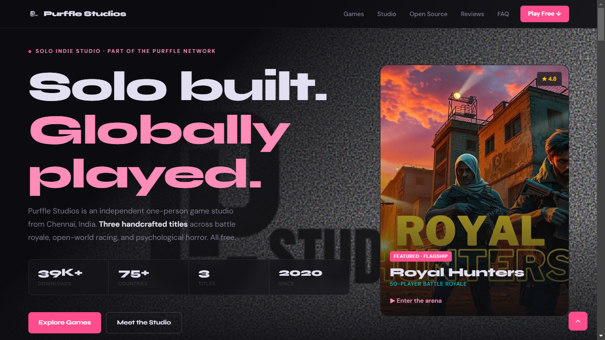
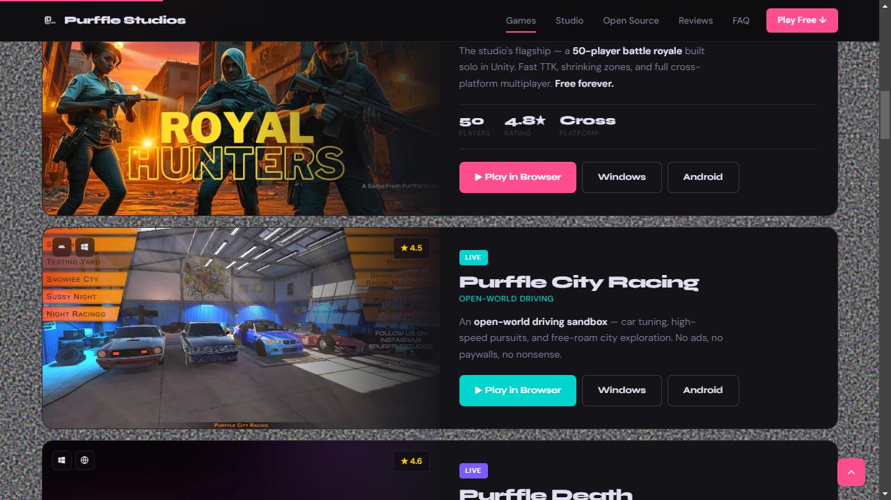

 

---

# Chaman Raj R — Python, AI and Desktop App Developer

I am a solo developer in **Chennai, India**, and I build and ship software on my own: **Python
automation and web scraping**, **custom AI chatbots** that answer from your documents instead of
inventing answers, **Electron desktop apps** for Windows, macOS and Linux, **Flask** dashboards and
trading bots, and **Unity** games. All of it runs under one brand — **Purffle** — and every project
below is live, free to use, and open to inspection before you decide whether I am any good.

**96,000+ downloads** across the network · **6 open-source repositories** · **180+ free web tools**
· **3 published games in 75+ countries** · everything designed, coded and shipped by one person.

**[Purffle Chartwright](#chartwright)** · **[Purffle AI](#purffleai)** ·
**[Claude Multi](#claude-multi)** · **[Purffle Grab](#purffle-grab)** ·
**[Purffle Trade](#purffle-trade)** · **[Trading bots](#purffle-trader)** ·
**[AI video](#purffle-vision)** · **[Purffle Tools](#purffle-tools)** ·
**[Purffle Studios](#purffle-studios)** · **[Hire me](#hire)**

> **Everything here is free.** No paid tiers, no accounts, no telemetry. Every GitHub project is MIT
> licensed; Purffle Chartwright is free but closed-source for now.

---

## 💼 Available for Hire — Python, AI Chatbots, Scraping & Spreadsheets

**I build this kind of thing for other people too — fixed price, agreed before I start.**

| Service | What you get | Turnaround | |
|---|---|---|---|
| **Custom AI chatbot** | Trained on *your* docs and FAQs so it stops inventing answers. GPT, Claude, Groq or Gemini. Full source code, no monthly fee to me. | 2–7 days | [Details →](https://www.fiverr.com/purffle/develop-a-custom-ai-chatbot-for-your-website) |
| **Python automation** | Batch file processing, Excel/CSV cleaning, API pulls, scheduled reports. Packaged as a double-click `.exe` if you don't use Python. | 1–5 days | [Details →](https://www.fiverr.com/purffle/write-a-python-script-to-automate-your-repetitive-tasks) |
| **Web scraping** | Clean, deduplicated data as Excel, CSV, JSON or Sheets — plus the scraper itself, so you can re-run it yourself. | 1–4 days | [Details →](https://www.fiverr.com/purffle/do-web-scraping-and-data-extraction-to-excel-or-csv) |
| **Excel & Google Sheets** | Formulas, live dashboards, pivots, macros and Apps Script — every formula explained in a notes tab. | 1–4 days | [Details →](https://www.fiverr.com/purffle/build-excel-and-google-sheets-formulas-dashboards-and-automation) |

> **The one rule I work by:** I only take work I can check myself before I deliver it. I run your
> script on your real sample data, I open the spreadsheet and verify the totals, I talk to the
> chatbot. If something is broken, I find out — not you. It's also why I turn work down: if I
> can't verify it, I'll say so instead of taking the money and hoping.

**The proof is this page.** Everything below is public, running, and yours to read before you spend
anything — six repositories, a live AI assistant you can talk to right now, a desktop app whose
language model is structurally unable to invent a number, 180+ free web tools and three shipped
games.

---

## 📐 Purffle Chartwright — Chart Analysis Where the AI Can't Invent a Number

**Ask a chatbot where support is and it will tell you — confidently, and from nowhere.** It picks a
satisfying round number, sounds certain, and never saw a bar. That is not a prompt you can fix; it
is what a text model does when asked about numbers it cannot see.

Chartwright removes the opportunity. A deterministic **Python engine computes the swing structure,
the level clusters, the indicators, the volatility and the position arithmetic first** — in about
two tenths of a second — and only then is a language model handed those figures and asked to
explain them. It has no access to raw bars, so it cannot state a price no tool returned, and every
figure in an answer expands into the function that produced it.

`Python` · `102 indicators` · `39 analysis tools` · `6 markets` · `8 timeframes` · `Ollama / OpenRouter / Anthropic / OpenAI`

- **Every price computed, never generated** — the model sees tool results, never the price series
- **Explain mode** — one plain-English sentence under every reading, generated from the value it sits under, so you do not need to already know what ADX is. Switch it off and the panel goes dense; the numbers are identical either way
- **Levels ranked by evidence** — touch count, recency, and how cleanly price respected each one
- **A backtester that does not flatter you** — next-bar-open fills, costs charged both sides, a bar holding both stop and target counted as a loss, and 10 strategies each labelled *published and replicated*, *published then decayed*, *folklore* or *unknown*
- **Journal scored in R**, the same unit the backtester reports in, so your execution and the system's history are directly comparable
- **Runs on your machine** — with a local model the entire loop works with no network at all
- **Not a predictor, and never connected to a broker.** It cannot place an order and it never will

<table>
<tr>
<td> <b>Every price is computed. None are invented.</b></td>
</tr>
</table>

> The published benchmark is in the box. Across three instruments and two questions, small local
> models asked without chart data gave 34 prices out of 72 that sat **outside everything the
> instrument had traded**. Handed this engine's output first: **0 out of 38**. The harness ships as
> `scripts/benchmark.py` so you can re-run it.

---

## 🧠 Purffle AI — A Free AI Assistant, No Signup, Seven Expert Modes

**This is the chatbot gig, running in public.** Open it and start typing — there is no account, no
key and no paywall between you and the model. Seven modes (general, code, creative writing,
analysis, translation, maths and tutoring) each carry their own system prompt and interface, and
the whole thing is a static front end talking to an inference API, which is exactly the shape most
"chatbot on my website" projects need.

`Llama 3.3` · `Groq` · `7 modes` · `No account` · `No tracking`

- **Nothing to sign up for** — no email wall, no trial, no credit card
- **Seven specialised modes**, not one prompt with a different label
- **Markdown, code blocks and syntax highlighting** in replies
- **Conversation history stays in your browser** — it is not collected

**If you want one of these trained on your own documents, that is
[the gig](https://www.fiverr.com/purffle/develop-a-custom-ai-chatbot-for-your-website)** — same
build, pointed at your content, with the source code handed over at the end.

---

## 🔄 Claude Multi — Run Claude Code with Multiple Accounts

**Never hit the Claude usage limit again.** The moment one account reaches its 5-hour cap, Claude Multi carries the full conversation to a free account and re-issues the interrupted instruction — your task keeps running instead of dying halfway.

`Electron` · `Claude Agent SDK` · `Windows` · `macOS` · `Linux` · no API key needed

- **Auto-switch** — seamlessly rotates to a free account the instant one hits its limit
- **24/7 Auto-loop** — runs prompts across accounts indefinitely, waits for resets, repeats
- **Parallel chats** — multiple conversations per project, each in its own session
- **Context inspector** — live view of token usage and context window health

<table>
<tr>
<td> <b>Main Interface</b> — Multi-account chat with live status</td>
<td> <b>Dashboard</b> — Account overview & cooldown timers</td>
</tr>
</table>

---

## ⬇️ Purffle Grab — YouTube & Spotify Downloader

**YouTube and Spotify downloader with an actual interface.** YouTube to MP3/MP4 up to 4K, Spotify playlists to MP3/FLAC with cover art attached. Built-in audio player, equalizer, and format converter. No ads, no signup, no upsell.

`Electron` · `yt-dlp` · `FFmpeg` · `Windows` · `macOS` · `Linux`

<table>
<tr>
<td> <b>Download</b> — Paste a link, pick format, go</td>
<td> <b>Player</b> — Built-in player with equalizer</td>
</tr>
</table>

---

## 💱 Purffle Trade — Social Copy-Trading for Crypto

**Copy the best crypto traders. Or become one and get paid.** 177 live markets, 100% free, non-custodial. Top traders post their moves and earn a cut every time someone copies and wins. Verified on-chain — real results, not influencer hype.

`177 Markets` · `Non-Custodial` · `On-Chain Verified` · `iOS & Android Coming Soon`

<table>
<tr>
<td> <b>Landing</b> — Copy winners in one tap</td>
<td> <b>Discover</b> — Live traders & market movers</td>
</tr>
</table>

---

## 📈 Purffle Trader — Crypto Paper-Trading Bot

**Scans 100 Binance pairs with an EMA + RSI strategy.** Real-time Flask dashboard, SQLite trade logging, and a 2-year backtest behind it. Paper trading only — built to test strategies, not to move real money.

`Python` · `Flask` · `SQLite` · `Binance API`

<table>
<tr>
<td> <b>Dashboard</b> — Real-time portfolio & P&L</td>
<td> <b>Backtest</b> — 2-year strategy comparison</td>
</tr>
</table>

---

## 🤖 Purffle CopyBot — Mirror Top Crypto Traders

**Copy-trading bot that mirrors top Hyperliquid traders.** Scans the on-chain leaderboard, aggregates consensus signals across multiple wallets, and ships with a backtesting suite covering 6 strategies.

`Python` · `Hyperliquid` · `On-Chain Data` · `Backtesting`

<table>
<tr>
<td> <b>Dashboard</b> — Elite traders & consensus signals</td>
<td> <b>Backtest</b> — 6 strategies compared</td>
</tr>
</table>

---

## 🎬 Purffle Vision & Purffle Shorts — AI Video Generation

**Faceless video generation, end to end.** Vision turns any topic into a finished YouTube video — GPT script, voiceover, stock footage, automated editing. Shorts runs the whole loop on autopilot: picks topics, writes scripts, generates voiceovers, assembles the video, and uploads it.

`Python` · `OpenAI` · `Coqui TTS` · `MoviePy` · `Flask`

<table>
<tr>
<td> <b>Vision Dashboard</b> — 5-step AI video pipeline</td>
</tr>
</table>

---

## 🛠️ Purffle Tools — 180+ Free Online Utilities

**Free online toolbox for developers, designers, students and professionals.** JSON, PDF, images, calculators, generators, validators, converters — over 180 utilities in one fast interface. No signup, no ads, no tracking.

`180+ Tools` · `19 Categories` · `No Signup` · `Zero Tracking`

<table>
<tr>
<td> <b>Homepage</b> — 180+ tools, zero friction</td>
<td> <b>Categories</b> — 19 categories, instant access</td>
</tr>
</table>

---

## 🎮 Purffle Studios — Indie Game Studio

**Solo indie game studio from Chennai, India.** Three handcrafted titles across battle royale, open-world racing and psychological horror. 39K+ downloads, 75+ countries, all free. Built in Unity.

`Unity` · `3 Games` · `39K+ Downloads` · `75+ Countries`

**Playable in your browser — no install, nothing to sign up for:**

<table>
<tr>
<td> <b>Homepage</b> — Solo built. Globally played.</td>
<td> <b>Games</b> — Royal Hunters & City Racing</td>
</tr>
</table>

---

## Tech Stack

---

**Need something like this built for you?**
I take on freelance work: AI chatbots, Python automation, web scraping and spreadsheet systems.

 

**If one of these saved you time, a ⭐ helps other people find it.**

[purffle.com](https://purffle.com) · [Purffle Trade](https://purffletrade.com) · [Purffle Tools](https://purffle.tools) · [Purffle AI](https://purffleai.com) · [Purffle Studios](https://purfflestudios.com)

Not affiliated with Anthropic, OpenAI, Google, Binance or Spotify. All product names are trademarks of their respective owners.

