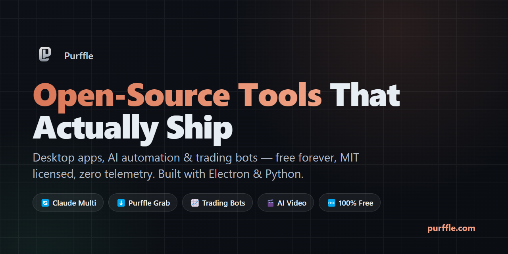

 

---

> **Everything is free, open source, and MIT licensed.** No paid tiers, no accounts, no telemetry. Desktop apps and AI automation tools — built with Electron and Python, always with a real GUI.

---

## 🔄 Claude Multi — Run Claude Code with Multiple Accounts

**Never hit the Claude usage limit again.** The moment one account reaches its 5-hour cap, Claude Multi carries the full conversation to a free account and re-issues the interrupted instruction — your task keeps running instead of dying halfway.

`Electron` · `Claude Agent SDK` · `Windows` · `macOS` · `Linux` · no API key needed

### Key Features

- **Auto-switch** — seamlessly rotates to a free account the instant one hits its limit
- **24/7 Auto-loop** — runs prompts across accounts indefinitely, waits for resets, repeats
- **Parallel chats** — multiple conversations per project, each in its own session
- **Context inspector** — live view of token usage and context window health
- **Command palette** — quick access to every action with keyboard shortcuts
- **Live cooldown timers** — see exactly when each account becomes available
- **Dark & light themes** — full UI theming with system preference detection

### Screenshots

<table>
<tr>
<td> <b>Main Interface</b> — Multi-account chat with live status</td>
<td> <b>Dashboard</b> — Account overview & cooldown timers</td>
</tr>
<tr>
<td> <b>Auto-Loop</b> — 24/7 automated prompt rotation</td>
<td> <b>Context Inspector</b> — Live token & context health</td>
</tr>
<tr>
<td> <b>Command Palette</b> — Keyboard-driven quick access</td>
<td> <b>Token Settings</b> — Token limits & model config</td>
</tr>
<tr>
<td> <b>Account Manager</b> — Add & manage accounts</td>
<td> <b>Usage Tracking</b> — Monitor all accounts</td>
</tr>
<tr>
<td> <b>Limit Detection</b> — Auto-detects usage caps</td>
<td> <b>Settings</b> — Customize everything</td>
</tr>
<tr>
<td> <b>Model Selector</b> — Pick your Claude model</td>
<td> <b>Effort Control</b> — Adjust reasoning effort</td>
</tr>
<tr>
<td> <b>Permissions</b> — Granular tool & file access</td>
<td> <b>Light Theme</b> — Clean light mode</td>
</tr>
</table>

---

## ⬇️ Purffle Grab — YouTube & Spotify Downloader

**YouTube and Spotify downloader with an actual interface.** YouTube to MP3/MP4 up to 4K, Spotify playlists to MP3/FLAC with cover art attached. Built-in audio player, equalizer, and format converter. No ads, no signup, no upsell.

`Electron` · `yt-dlp` · `FFmpeg` · `Windows` · `macOS` · `Linux`

<table>
<tr>
<td> <b>Download</b> — Paste a link, pick format, go</td>
<td> <b>Playlists</b> — Batch download with track selection</td>
</tr>
<tr>
<td> <b>Player</b> — Built-in player with equalizer</td>
<td> <b>Stats</b> — Download metrics & history</td>
</tr>
</table>

---

## 📈 Purffle Trader — Crypto Paper-Trading Bot

**Scans 100 Binance pairs with an EMA + RSI strategy.** Real-time Flask dashboard, SQLite trade logging, and a 2-year backtest behind it. Paper trading only — built to test strategies, not to move real money.

`Python` · `Flask` · `SQLite` · `Binance API`

<table>
<tr>
<td> <b>Dashboard</b> — Real-time portfolio & P&L</td>
<td> <b>Backtest</b> — 2-year strategy comparison</td>
</tr>
</table>

---

## 💱 Purffle Trade — Live Crypto Trading Platform

**Real-time cryptocurrency trading with professional-grade tools.** Multi-exchange support, advanced charting, portfolio tracking, and automated order execution.

`Python` · `Multi-Exchange` · `Real-Time Charts`

---

## 🤖 Purffle CopyBot — Mirror Top Crypto Traders

**Copy-trading bot that mirrors top Hyperliquid traders.** Scans the on-chain leaderboard, aggregates consensus signals across multiple wallets, and ships with a backtesting suite covering 6 strategies.

`Python` · `Hyperliquid` · `On-Chain Data` · `Backtesting`

<table>
<tr>
<td> <b>Dashboard</b> — Elite traders & consensus signals</td>
<td> <b>Backtest</b> — 6 strategies compared</td>
</tr>
</table>

---

## 🎬 Purffle Vision & Purffle Shorts — AI Video Generation

**Faceless video generation, end to end.** Vision turns any topic into a finished YouTube video — GPT script, voiceover, stock footage, automated editing. Shorts runs the whole loop on autopilot: picks topics, writes scripts, generates voiceovers, assembles the video, and uploads it.

`Python` · `OpenAI` · `Coqui TTS` · `MoviePy` · `Flask`

<table>
<tr>
<td> <b>Vision Dashboard</b> — 5-step AI video pipeline</td>
</tr>
</table>

---

## Tech Stack

---

**If one of these saved you time, a ⭐ helps other people find it.**

[purffle.com](https://purffle.com) · [Purffle Studios](https://purfflestudios.com) · [Purffle Tools](https://purffle.tools) · [Purffle Trade](http://purfletrade.com/)

Not affiliated with Anthropic, OpenAI, Google, Binance, or Spotify. All product names are trademarks of their respective owners.

